# Arquitectura implementada del backend

Refactor técnico desde `integracion3@8eceb05a6206db9c6f9309766fec8aaed2db06b6`.
No agrega funcionalidades, tablas, atributos persistidos, migraciones ni dependencias.
El frontend Expo y sus contratos HTTP se conservan.

El [diagrama Mermaid](architecture.mmd) representa los componentes del código y sus
dependencias agrupadas. El [registro del refactor](REFACTOR.md) contiene verificaciones,
decisiones y límites; [REFACTOR_FILES.md](REFACTOR_FILES.md) enumera los movimientos.

## Organización

```text
src/
  app.ts                         # Ensamblaje HTTP sin listen ni conexiones
  bootstrap.ts                   # Conectar, comprobar, escuchar y cerrar
  server.ts                      # Entorno, arranque, workers y señales
  readiness.ts                   # Composición de los siete diagnósticos existentes
  config/                        # Entorno; adaptador histórico Mongo documentado
  database/
    supabase/                    # SDK, pool pg, transacciones, sondas y migraciones
    mongodb/                     # Cliente, sondas y migración histórica005
    redis/                       # Cliente y contador atómico de cuotas
    health.ts                    # Sondas comunes de dependencias
  routes/index.ts                # Montaje versionado /api/v1
  modules/
    auth/
    users/
    maps/
    activities/
    analytics/
    reports/
    marketplace/
      domain/                    # Reglas comunes de valoración
      repositories/              # Mensajes, valoraciones y avisos compartidos
      public.ts                  # Capacidades compartidas explícitas
      physicalgoods/
      elibrary/
  shared/
    errors/                      # ApiError
    http/                        # Sobres, validación, políticas y middleware
    pagination/                  # Parseo y metadatos
    health/                      # Sondas por módulo y respuesta segura
    async/                       # Deadline
    rate-limit/                  # Contrato de contador y política de cuotas
tests/                           # HTTP, dominio, SQL, Mongo simulado y arquitectura
qa/                              # Fixtures y herramientas del entorno de QA existente
scripts/check-architecture.mjs    # Inspección de dependencias sin ejecutar la aplicación
```

Cada módulo conserva su `*.routes.ts` en la raíz y crea únicamente las carpetas que
utiliza: `controllers`, `services`, `repositories`, `types`, `domain`, `validators`,
`middleware`, `workers`, `exports` o `files`. No existe una carpeta vacía por cada
bloque del UML. Los nombres históricos `map.*`, `physicalgoods.*` y `elibrary.*`
se conservan para facilitar el seguimiento de Git.

## Responsabilidades y flujo

1. La **Screen** permanece en Expo: `app/`, `src/features/` y `src/three/`.
2. **Endpoint** es método+ruta Express. `app.ts` monta protección de origen antes
   del parseo y `/api/v1` monta los routers funcionales. Uploads conservan su
   parseo diferido después de autenticar.
3. **Controller** adapta parámetros/cuerpos, invoca servicios y entrega HTTP.
   Los validadores de formato están en `validators`; multipart conserva sus
   helpers acotados y su orden de autenticación previo.
4. **Service** coordina el caso de uso, autorización, contexto vigente y resultados.
   Conserva las dependencias inyectables usadas por las pruebas.
5. **Repository** ejecuta SQL, consultas Mongo y operaciones de Storage/Auth.
   Conserva los clientes compartidos, transacciones, locks, filtros e idempotencia.
6. **Model** son interfaces, documentos, filas SQL y DTO existentes. No es una
   capa ejecutable adicional ni exige clases u ORM. Los contratos están en
   `types` y algunos contratos de inyección permanecen cerca del servicio que los usa.

Ejemplo: `GET /api/v1/activities/:activityId` pasa por autenticación y validación,
`activities.controller`, `activities.detail.service`, políticas de visibilidad y
referencias, repositorios de actividades/perfiles y clientes Mongo/Supabase.
La respuesta conserva su DTO; una referencia no vigente no expone contenido.

La autorización real permanece en servidor y se repite bajo transacción donde ya
existía. Mover archivos no convierte un guard del frontend en permiso de acceso.

## Mapa de módulos

| Módulo | Controladores y servicios principales | Repositorios y contratos |
| --- | --- | --- |
| auth | `auth.controller`; `auth.service`; middleware de identidad y validators de credenciales/registro | `auth.repository`; `AuthProfile`, `VerifiedAuthConnection`; políticas de campus/propiedad en domain |
| users | `users`, `access`, `notifications.controller`; servicios de perfil, accesos, auditoría y notificaciones | users/access/notifications/audit.activities/profile-overview; `AuditDetail`, `NotificationPage`, `ProfileOverview` |
| maps | `map.controller`, `map.service` | `map.repository`; `CampusMapDocument`, jerarquía `SpatialBuilding` |
| activities | `activities.controller`; consulta, creación, edición, detalle, series, gestión, referencias y lecturas propias | Repositorios por operación; `ActivityDocument`, participación, cambios, notificaciones; políticas, recurrencia y ubicación |
| physicalgoods | `physicalgoods.controller`; publicación, imágenes, edición, solicitudes, transacciones, historial y recordatorios | Repositorios físicos; `PhysicalgoodsInput`, filas de publicación/solicitud/transacción |
| elibrary | `elibrary.controller`; archivos, académicos, búsqueda, acuerdos, adquiridos, recomendaciones, mensajes y valoración | Repositorios digitales; `DigitalResourceRow`, `DigitalTradeRow`, `DigitalStoredFile`; parser multipart y extractor PDF aislado |
| analytics | `analytics.controller`, `analytics.service`; domain de períodos/presentación y exportadores PDF/Excel | `analytics.repository` (eventos/salud), `analytics.reports.repository` (snapshots), `analytics.dashboard.repository` (SQL), `analytics.activities.repository` (Mongo); `DashboardData`, `AnalyticalReport` |
| reports | `reports.controller`; denuncia, revisión, resolución y coordinación de contenido físico/digital | reports/review/resolution/elibrary; `ContentReportReceipt`, `ReportReviewDetail`, `ReportResolutionInput`, snapshots originales |

`reports` gestiona denuncias. Los reportes analíticos y sus instantáneas pertenecen
a `analytics`; no se mezclan porque compartan el nombre de «reporte».

## Dependencias entre módulos

- Un módulo consume capacidades ajenas mediante `public.ts`, contratos `types`,
  funciones puras `domain` o el middleware público de auth. No importa repositorios
  privados de otro módulo.
- `public.ts` exporta una lista explícita de funciones existentes, sin duplicarlas.
  Algunas operaciones públicas reciben el `PoolClient` del llamante para conservar
  **la misma transacción y el mismo orden de locks**. La interfaz pública no elimina
  las revalidaciones del repositorio.
- Auth proporciona identidad, estado, permisos y políticas. Maps proporciona mapa
  autorizado y referencias espaciales. Activities los usa antes de operar.
- Users consulta contadores físicos/digitales, cambios de actividad y mapas para
  auditoría. El worker de activities entrega avisos mediante la API pública de users.
- Físicos y digitales comparten únicamente mensajes, valoración, notificaciones y
  funciones de identificación de operaciones de analytics. Sus reglas permanecen separadas.
- Reports coordina lectura de evidencia y moderación de los módulos propietarios,
  revalida el alcance administrativo y conserva su recuperación SQL/Mongo existente.
- La composición (`routes/index`, `readiness`, `server`) monta rutas, diagnósticos y
  workers. `shared/http/endpoint-policy` integra intencionalmente el middleware auth
  para impedir endpoints sin política declarada.

Hay colaboración funcional en ambos sentidos entre algunas agrupaciones, como
users/activities. Esto no implica un ciclo de imports entre archivos: se comprueba
el grafo de ejecución, incluidos imports dinámicos con ruta literal. No se afirma
que el grafo agregado de nombres de módulos sea un DAG.

## Persistencia y procesos

- **PostgreSQL/Supabase:** perfiles, campus, roles, permisos, publicaciones,
  solicitudes, transacciones, auditoría y reportes. SDK y pool `pg` conservan sus
  usos originales; Storage mantiene archivos privados y firmas autorizadas.
- **MongoDB:** mapas, actividades, participación e interacciones. Se mantienen
  ObjectId propios y UUID relacionales. Existencia/estado/campus se verifican en
  aplicación; no hay una transacción distribuida nueva.
- **Redis:** dependencia de infraestructura para rate limiting distribuido.
  Contadores hash y TTL atómicos compartidos entre instancias;429 con `Retry-After`.
  Production exige Redis; caída produce503. Memoria limitada únicamente en
  development/test sin URL. No almacena entidades ni sustituye PostgreSQL/Mongo.
- **Workers:** notificaciones/lifecycle de actividades y recordatorios físicos
  conservan arranque, reintento y cierre. La extracción PDF continúa en un worker
  aislado con los límites existentes, diferente de los workers periódicos.

El arranque conecta MongoDB/Redis y ejecuta los diagnósticos existentes de Supabase
y Mongo. El pool PostgreSQL se abre bajo demanda; no se añadió una sonda de arranque
que cambie el comportamiento anterior.

La edición de actividades tenía una dependencia recíproca servicio/repositorio.
Ahora `ActivityEditPlanner` es un contrato del módulo: el servicio pasa el
planificador al repositorio y este lo ejecuta con lectores de **su transacción Mongo**.
No se retira el segundo cálculo, el control de revisión, los checks de propietario
o el control de cupo. La política individual queda en `domain/activities.edit.ts`.

## Diferencias justificadas respecto del UML original

| UML conceptual | Implementación real |
| --- | --- |
| Usuario como un perfil pequeño | users incluye permisos, estados, auditoría y bandeja; auth conserva identidad/registro/sesión |
| MarketplaceService y PublicacionRepository únicos | physicalgoods y elibrary conservan sus reglas y repositorios específicos; solo se comparten operaciones realmente comunes |
| Actividad por edificio/piso | activities mantiene creación, series, edición, participación, historial, avisos y referencias; maps mantiene el mapa Mongo y la geometría continúa en Expo |
| Un Model por módulo | Interfaces/documentos/DTO existentes, sin clases artificiales, ORM ni campos nuevos |
| Analítica con un repositorio único | Repositorios por SQL de dashboard, instantáneas y eventos Mongo; exportación separada |
| Resolución de reporte simple | Se conserva coordinación recuperable SQL/Mongo y auditoría; no se inventa atomicidad entre motores |
| Flujo lineal sin infraestructura | Se muestran middleware, clientes, Redis, workers, contratos y llamadas entre módulos reales |

Se conservan cuatro puntos de compatibilidad mínimos porque la migración005 es
inmutable: `config/mongodb.ts` y `activities.{types,interactions,participation}.ts`.
Son reexports a una única implementación; el código operativo utiliza las nuevas
rutas. No se deja una segunda implementación activa.

Los fuentes conservan `import/export`, extensiones relativas `.js` y
`moduleResolution: NodeNext`. El `package.json` existente no declara `type: module`,
por lo que la compilación conserva CommonJS y los usos existentes de
`require`/`__filename`. Convertir la ejecución a ESM estricto sería otro cambio;
este refactor conserva la compatibilidad del despliegue actual.

## Verificar y modificar

```sh
npm run typecheck
npm run build
npm test
npm run check:architecture
node --test qa/tests/fixtures.test.mjs
```

El comprobador usa parsers experimentales incorporados en Node22; muestra sus
advertencias y no agrega dependencias. Analiza imports estáticos y dinámicos con
ruta literal; imports construidos a partir de variables y código generado requieren
revisión adicional. Sus pruebas incluyen ciclos dinámicos y acceso privado indebido.

Para extender un módulo: comenzar por su ruta/controlador, revisar el servicio y
sus políticas, mantener consultas en repositorios y ampliar `public.ts` únicamente
si existe un consumidor externo real. Leer el contexto histórico de la tarea y
ejecutar las pruebas relacionadas. No usar la reorganización como motivo para
reescribir SQL funcional, eliminar checks transaccionales o modificar migraciones.

## Diagrama Mermaid de componentes

Fuente: [architecture.mmd](architecture.mmd). Este bloque reproduce la misma fuente
para que los visores Markdown compatibles puedan renderizarla.

```mermaid
flowchart TB
  Expo["Frontend Expo / Expo Router<br/>Screens, hooks y clientes API existentes"]
  Entry["server.ts → bootstrap.ts<br/>Conexión, readiness, listen y cierre"]
  App["app.ts: createApp<br/>Helmet, CORS y JSON diferido para uploads"]
  Http["shared/http<br/>Cuota de origen, endpoint-policy<br/>auth.middleware y validación según ruta"]
  Routes["routes/index.ts<br/>Montajes /api/v1 y health/ready"]
  Error["shared/http/error-handler.ts<br/>ApiError, sanitización y Retry-After"]
  Shared["shared<br/>Respuestas, paginación, health<br/>deadline y contratos HTTP"]
  Limits["shared/rate-limit<br/>Cuotas IP / identidad verificada"]
  RedisClient["database/redis/rate-limit.redis.ts"]
  Redis[("Redis<br/>Contadores y TTL temporales compartidos")]
  PG[("PostgreSQL / Supabase<br/>Perfiles, campus, grants, publicaciones<br/>solicitudes, transacciones, auditoría y reportes")]
  Mongo[("MongoDB<br/>campus_maps, activities<br/>activity_participation, activity_interactions")]
  Supabase["Supabase Auth / Data API / Storage<br/>Identidad, consultas y archivos privados"]
  Clients["database/supabase + database/mongodb<br/>Clientes, pools, transacciones y sondas"]

  Entry --> App
  Expo -->|"HTTP: contratos vigentes /api/v1"| App
  App --> Http --> Routes
  App --> Error
  Http --> Limits --> RedisClient --> Redis
  Entry -->|"connect / verify / close"| Clients
  Entry -->|"connect / close"| RedisClient
  Clients --> PG
  Clients --> Mongo
  Clients --> Supabase
  App -.-> Shared

  subgraph Auth["auth"]
    AR["auth.routes.ts"] --> AC["controllers/auth.controller.ts"]
    AC --> AS["services/auth.service.ts<br/>validators/auth.validation.ts"]
    AS --> AQ["repositories/auth.repository.ts"]
    AM["types/auth.types.ts<br/>AuthProfile / VerifiedAuthConnection"]
    AP["domain/auth.authorization.ts<br/>Cuenta, campus, capacidades y propiedad"]
    AS -.-> AP
    AQ -.-> AM
  end
  subgraph Users["users"]
    UR["users.routes.ts / notifications.routes.ts"] --> UC["controllers<br/>users / access / notifications"]
    UC --> US["services<br/>Perfil, accesos, auditoría, notificaciones"]
    US --> UQ["repositories<br/>users / access / notifications<br/>audit.activities / profile-overview"]
    UM["types<br/>Auth/account DTO, AuditDetail<br/>NotificationPage / ProfileOverview"]
    UQ -.-> UM
  end
  subgraph Maps["maps"]
    MR["map.routes.ts"] --> MC["controllers/map.controller.ts"]
    MC --> MS["services/map.service.ts"]
    MS --> MQ["repositories/map.repository.ts"]
    MM["types/map.types.ts: CampusMapDocument<br/>domain/map.location.ts: SpatialBuilding"]
    MQ -.-> MM
  end
  subgraph Activities["activities"]
    VR["activities.routes.ts"] --> VC["controllers/activities.controller.ts"]
    VC --> VS["services<br/>Consulta, creación, edición, series<br/>participación, referencias e historial propio"]
    VS --> VQ["repositories<br/>Documentos, historial, participación<br/>interacciones, referencias y lifecycle"]
    VM["types + domain<br/>ActivityDocument / ActivityParticipationDocument<br/>ActivityChangeDocument / ActivityEditPlanner<br/>Políticas, recurrencia y ubicación"]
    VQ -.-> VM
    VS -.-> VM
    VW["workers/activities.notifications.worker.ts"] --> VQ
    VQ -.->|"Callback de plan revalidado<br/>en la misma transacción"| VM
  end
  subgraph Physical["marketplace/physicalgoods"]
    PR["physicalgoods.routes.ts"] --> PC["controllers/physicalgoods.controller.ts"]
    PC --> PS["services<br/>Publicación, imágenes, edición, solicitudes<br/>transacciones, historial y recordatorios"]
    PS --> PQ["repositories<br/>Publicaciones, medios, solicitudes<br/>transacciones, historial y recordatorios"]
    PM["types/physicalgoods.types.ts<br/>PhysicalgoodsInput / PhysicalgoodsMediaRow<br/>PhysicalgoodsRequestRow / PhysicalgoodsTransactionRow"]
    PQ -.-> PM
    PW["workers/physicalgoods.reminders.worker.ts"] --> PS
  end
  subgraph Digital["marketplace/elibrary"]
    DR["elibrary.routes.ts"] --> DC["controllers/elibrary.controller.ts"]
    DC --> DS["services<br/>Publicación, archivos, búsquedas, acuerdos<br/>adquisiciones, recomendaciones, chat y valoración"]
    DS --> DQ["repositories<br/>Recursos, académicos, acuerdos<br/>adquisiciones, recomendaciones y valoración"]
    DM["types/elibrary.types.ts<br/>DigitalResourceRow / DigitalTradeRow<br/>DigitalStoredFile y contratos DTO"]
    DQ -.-> DM
    DU["middleware/elibrary.upload.ts<br/>Parser multipart acotado"]
    DF["files/elibrary.preview.extractor.ts<br/>Worker aislado de extracción PDF"]
    DC --> DU
    DS --> DF
  end
  subgraph Analytics["analytics"]
    NR["analytics.routes.ts"] --> NC["controllers/analytics.controller.ts"]
    NC --> NS["services/analytics.service.ts<br/>domain: períodos y presentación"]
    NS --> NQ["repositories<br/>analytics: eventos / reports: snapshots<br/>dashboard: SQL / activities: agregación Mongo"]
    NM["types/analytics.types.ts<br/>DashboardData / AnalyticalReport<br/>ResourceAnalyticsEvent"]
    NQ -.-> NM
    NS --> NX["exports/analytics.export.ts + analytics.pdf.ts<br/>PDF y Excel de instantáneas guardadas"]
  end
  subgraph Reports["reports: denuncias de contenido"]
    RR["reports.routes.ts"] --> RC["controllers/reports.controller.ts"]
    RC --> RS["services<br/>Denuncia, revisión y resolución<br/>Físicos, digitales y actividades"]
    RS --> RQ["repositories<br/>reports / review / resolution / elibrary"]
    RM["types/reports.types.ts<br/>ContentReportReceipt / ReportReviewDetail<br/>ReportResolutionInput / ActivityReportSnapshot"]
    RQ -.-> RM
  end
  Common["marketplace común<br/>domain/marketplace.rating.ts<br/>repositories: mensajes, valoración y notificaciones"]

  Routes --> AR & UR & MR & VR & PR & DR & NR & RR
  Http -->|"Identidad verificada por Supabase"| AS
  AQ --> Clients
  UQ --> Clients
  MQ --> Clients
  VQ --> Clients
  PQ --> Clients
  DQ --> Clients
  NQ --> Clients
  RQ --> Clients
  Common --> Clients
  Entry --> VW & PW

  US -->|"API pública: historial y contadores"| PS & DQ
  UQ -->|"API pública: contadores físicos/digitales"| PQ & DQ
  US -->|"Lectura de cambios y mapa autorizado"| VQ & MS
  UQ -->|"Mapa para auditoría"| MQ
  VS -->|"Mapa y referencias de ubicación"| MS
  VW -->|"users/public: entrega durable"| UQ
  PS -->|"Punto de encuentro"| MQ
  PS & DS -->|"Funciones públicas de operación/idempotencia"| NS & NQ
  PS & DS & PQ --> Common
  RS -->|"APIs públicas de contenido y evidencia"| PQ & PS & DQ & DS & VQ & VS & MS
  RS -->|"Revalidación administrativa en transacción"| UQ
  VS & US & MS & PS & DS & NS & RS --> AP

  Note["Flechas continuas: llamadas/imports de ejecución agrupados.<br/>Flechas punteadas: modelos, contratos y políticas.<br/>Los modelos son tipos/documentos existentes, no clases ORM.<br/>La colaboración entre módulos usa public.ts, domain/types y middleware auth.<br/>Grafo real de archivos validado sin ciclos runtime."]
```


